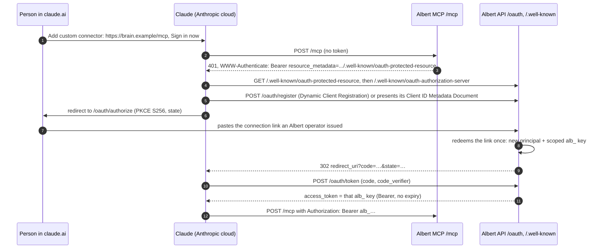

# claude.ai connector (web, Desktop, mobile)

Claude's web app, Desktop app and mobile apps reach memory through **connectors**:
remote MCP servers that Anthropic's cloud calls over public HTTPS, with each person
signing in through OAuth. Albert's MCP server already speaks streamable HTTP and
forwards each caller's bearer key; this page adds the OAuth front that lets Claude
obtain such a key for a person without anyone pasting credentials into Claude.



What this means operationally:

- **No user accounts in Albert.** The person proves they are allowed in by presenting a
  connection link, which an operator mints in the console (Settings → connection
  links) with the capabilities and workspace the connector should have. One link,
  one person, one principal: revoking that key in the console disconnects exactly
  that person's Claude.
- **The access token is the Albert key.** Nothing new to validate in the MCP server or
  the REST API, and audit attribution works as for any agent. Tokens do not expire,
  so there is no refresh token; Claude keeps using the key until it is revoked.
- **Public clients only, PKCE required.** Claude registers through Dynamic Client
  Registration (`/oauth/register`) or identifies itself with a Client ID Metadata
  Document; both are accepted. `token_endpoint_auth_method` is `none`; S256 PKCE is
  mandatory; redirect URIs must be `https://` or loopback `http://` (Claude Code),
  and the `redirect_uri` on each request must match a registered one exactly
  (loopback may vary the port).
- **Codes are short-lived and single use.** An authorization code lives ten minutes,
  the minted key is stored AES-GCM-sealed with a key derived from
  `ALBERT_API_KEY_PEPPER` until it is exchanged, and the row is deleted on first use
  whatever the outcome.

## Enable it

1. Decide the public HTTPS origin, for example `https://brain.example.com` or a
   Tailscale Funnel name such as `https://host.tailnet.ts.net:10000`. Route
   `/mcp` to the MCP server (port 8081) and `/oauth/*` plus `/.well-known/*` to the
   API (port 8080). Nothing else on the API needs to be public; `/v1/*` can stay
   private.
2. Set, for both `api` and `mcp`:

   ```dotenv
   ALBERT_OAUTH_ISSUER=https://brain.example.com
   ALBERT_PUBLIC_MCP_URL=https://brain.example.com/mcp
   ```

   Without `ALBERT_OAUTH_ISSUER` every `/oauth` and `/.well-known` route answers 404
   and the MCP server's 401 carries a plain `Bearer` challenge, as before.
3. Recreate `api` and `mcp`. Verify:

   ```bash
   curl -s https://brain.example.com/.well-known/oauth-authorization-server | jq .issuer
   curl -si -X POST https://brain.example.com/mcp -d '{}' | grep -i www-authenticate
   ```

## Connect a person

1. In the console, Settings, create a **connection link** for the workspace the
   person should work in, with capabilities such as `memory.read, memory.write,
   graph.query, working_memory.read, working_memory.write`. Send it to the person
   privately; it expires (default one hour) and works once.
2. In claude.ai: **Settings → Connectors → Add custom connector**. Name it, enter the
   MCP URL (`https://brain.example.com/mcp`), choose **Sign in now**, leave the OAuth
   client on **Register automatically** (or **Use Claude's published identity**), and
   continue. Claude opens Albert's authorization page.
3. Paste the connection link, optionally name the connection, and click **Connect**.
   Claude returns to its connectors page with Albert connected; its 22 memory tools
   are available in every chat where the connector is enabled.

Claude Code can use the same server with `claude mcp add --transport http albert
https://brain.example.com/mcp`; it signs in through the same flow with a loopback
redirect. Albert's Claude Code plugin remains the richer option there, since it also
captures and recalls automatically through hooks.

## Revoke and rotate

Revoke the person's key in the console (Settings → credentials; it is named after the
connection, for example "Claude (connector)"). Claude's next call gets 401 and prompts
the person to sign in again, which needs a new link. There is nothing to rotate on
the server side; `ALBERT_API_KEY_PEPPER` must stay constant as for every key.

## Not supported

- Refresh tokens (`unsupported_grant_type`): tokens do not expire.
- Confidential clients and client secrets: Claude's connector client is public.
- Anthropic's static request-header auth (beta) works too, without this page: the
  Owner enters an Albert key as the `Authorization` header when adding the connector.
